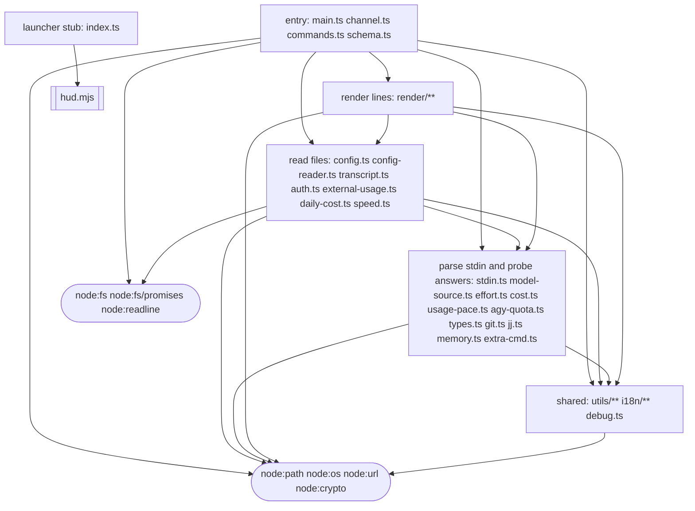

# Architecture

Agents own the logic. The owner owns the capabilities. The runtime enforces the line, twice: on
GitHub's machines, and on every user's machine, where the HUD runs.
A capability is anything that touches the world: running a program, writing a file outside one
folder, the network, a key/keyring, posting, merging. Everything else is logic.

```
                 USER (after each Antigravity CLI step)
 LOGIC     ┌─ src/**/*.ts, caged ────────────────────────┐
 (agent)   │ parse stdin, ask for probes, render lines,  │
           │ the /hud subcommands; writes data/ only     │
═══════════╪═════ JSON lines on fd 0 and 1 ══════════════╪═══
 CAPABILITY│ hud.mjs: runCage, terminalFilter, --update  │
 (owner)   │ collector.mjs: every path, every program    │
           │   (git, jj, vm_stat, extra cmd, quota SWR)  │
           │ fence.mjs + node --permission: the cage     │
           │ install.mjs: writes the statusLine setting  │
           │ runtime/quota/*.mjs: OAuth & quota SWR      │
           │ scripts/statusline.mjs: latest launcher     │
           └─────────────────────────────────────────────┘
```

On the user's side, one render is:

```
agy CLI ─stdin─▶ hud.mjs ─▶ collector.mjs: paths (logicPaths), data/, probes, and stripped/:
                    │       src/ with types removed by Node's own stripper, read-only to logic
                    └─▶ runCage: node --permission --allow-fs-read=<each path, stripped/> --allow-fs-write=data/
                                 --import=fence.mjs src/main.ts
                          ─▶ {stdin, now, paths}  ◀─ ask: ["git.status", "agy.quota", …] ─▶ answers  ◀─ {lines, snapshot?}
       terminal ◀─ terminalFilter: colour, and links to file: or the session's own GitHub repo
```

Every check in `verify/` goes through the same `runCage`. Logic never sees OAuth access tokens,
keyring readers, or `PATH`; `collector.mjs` resolves Antigravity quota, tier, and account email
via `runtime/quota.mjs` outside the cage and passes only redacted JSON data through `agy.quota`.

## The logic side, as a test

This diagram is a test. `verify/arch.check.mjs` reads it and compares it with the runtime imports
in `src/` (type-only imports vanish when Node strips the types). It fails if a file is in no box
or in two, if an import crosses boxes with no arrow for it, if an arrow is drawn that no import
uses, or if the rounded nodes are not exactly the builtins `fence.mjs` lets logic load.



`fsio` is bounded by `--permission`: logic reads only the paths `collector.mjs` names in `paths`
and writes only `data/`. Nothing in `src/` can reach `node:child_process`, `node:net` or any other
builtin: `fence.mjs` refuses the import, and `verify/arch.check.mjs` refuses the diagram.
